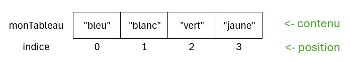
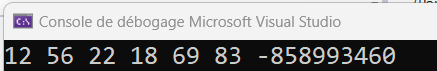

# Les tableaux

**Définition** : Un tableau est une structure de données, un conteneur, qui permet de stocker plusieurs valeurs du même type de façon consécutive en mémoire. On peut y accéder en connaissant le nom du tableau et la position de l'élément auquel vous voulez accéder. Pour le déclarer, on doit connaître la taille du tableau (combien d'éléments on veut mettre dedans) et le type des éléments qu'on y mettra.

```cpp
int notes[5] = {90, 85, 70, 88, 95};
```

Pour accéder ou remplacer une valeur dans un tableau, on doit spécifier le nom du tableau suivi de l'indice (index) de cet élément:

```cpp
cout << "La valeur du tableau notes à l'indice 2 est: "<< notes[2];
note[2] = 75; //On écrase la valeur
cout << "La nouvelle valeur du tableau notes à l'indice 2 est: "<< notes[2];
```
## Indice (index)

Comme vous avez remarqué à l'exemple précédent, l'élément à l'indice 2 était en réalité le 3e élément du tableau. en fait, l'indice (ou l'index) de la case est le **nombre de cases de décallage par rapport à la première case**. C'est pourquoi la première case est la case 0, puisqu'elle a 0 case de décallage avec elle-même. En informatique, on compte alors très souvent à partir de 0.

Par exemple, si on déclare un tableau de strings:
```cpp
string monTableau[4] = {"bleu", "blanc", "vert", "jaune"};
```
on aura ceci:



## Parcourir un tableau

Pour parcourir toutes les valeurs d'un tableau, on utilise une boucle. Puisque la taille d'un tableau est fixe, la boucle `for` est pratique.

```cpp
int monTableau[6] = {12,56,22,18,69,83};

//afficher chaque élément du tableau
for (int i = 0; i < 6; i++) {
    cout << monTableau[i] << " ";
}
```
**Attention!** Il ne faut pas aller à l'extérieur du tableau définit si on ne veut pas de mauvaises surprises:

```cpp
//Ne pas faire
for (int i = 0; i < 7; i++) {
    cout << monTableau[i] << " ";
}
```
Résultat: <br>




## Assigner ou changer une valeur

Pour assigner une valeur, il faut utiliser le nom du tableau et l'indice comme un tout qui représente la "variable". Pour remplacer la valeur 22 par 25 dans monTableau, je dois faire:

```cpp
monTableau[2] = 25;  // 25 écrase la valeur dans le tableau à l'indice 2 (3e place)
```

## Taille d'un tableau

On peut obtenir la taille (capacité totale) d'un tableau en faisant la fonction size(), qui retourne le nombre total d'éléments dans le tableau:

```cpp
for (int i = 0; i < size(monTableau); i++){
    cout << monTableau[i];
}
```

Il est aussi possible de faire ceci manuellement pour les versions moins récentes de C++ ou dans certaines situations particulière. La fonction sizeof() retourne le nombre d'octets occupé en mémoire par l'élément entre parenthèse plutôt que le nombre d'éléments. Il faut ensuite diviser avec la taille d'une case pour avoir le nombre d'éléments dans le tableau. Si par exemple sizeof(monTableau) est de 24 octets et qu'une case prend 4 octets, on sait alors qu'on a 24/4 = 6 éléments dans le tableau.

```cpp
int taille = sizeof(monTableau) / sizeof(monTableau[0]); // on peut placer ce calcul dans une variable si on veut alléger l'écriture de la boucle.

for (int i = 0; i < taille; i++){
    cout << monTableau[i];
}
```

Autre notation (*for-each*) (Seulement si on n'a pas besoin de l'indice de chaque élément):

```cpp
int mesNombres[5] = {10, 20, 30, 40, 50};
for (int n : mesNombres) {
  cout << n << endl;
}
```


### Exemple 1

Remplir un tableau de taille 7 avec des valeurs que l'utilisateur fournit. Parcourir le tableau et trouver le maximum et le minimum. Afficher-les à la fin. 

Le code a été placé dans une fonction nommée maxEtMin() et appelée du main()

```cpp
void maxEtMin() {
	int merveilleuxTableau[7];
	int taille = size(merveilleuxTableau);
	for (int i = 0; i < taille; i++) {
		cout << "Entrer la valeur #" << i << " du tableau: ";
		cin >> merveilleuxTableau[i];
		cout << endl;
	}
	int maximum = INT_MIN;
	int minimum = INT_MAX;

	for (int i = 0; i < taille; i++) {
		if (merveilleuxTableau[i] < minimum) {
			minimum = merveilleuxTableau[i];
		}

		if (merveilleuxTableau[i] > maximum) {
			maximum = merveilleuxTableau[i];
		}
	}
	cout << "Le minimum est: " << minimum << endl;
	cout << "Le maximum est: " << maximum << endl;
}

int main(){
	maxEtMin();
	return 0;
}
```

### Exercice 1

Mettre les valeurs suivantes dans un tableau et trouver le nombre de lettres 'A' ou 'a' qui s'y trouvent.

```cpp
{ 'A', 'n', 'G', 'b', 'd', 'A', 'M', 'x', 'I', 'p', 'C', 'L', 'z', 'h', 'O', 'K', 'j', 'T', 'S', 'a','f', 'W', 'Y', 'l', 'r', 'U', 'C', 'v', 'Q', 'm', 'B', 'e', 'd', 'I', 'k', 'P', 'N', 'f', 'a', 'o' };
```


### Exemple 2

Les chaînes de caractères (string) se traitent aussi comme des tableaux. On peux aussi prendre la fonctionnalité .size() pour obtenir la taille de la chaîne de caractères. Ici, le code inverse une chaîne de caractères:

```cpp
void exemple2(){
    string texte, inverse = "";

    cout << "Entrez une chaîne de caractères : ";
    getline(cin, texte); //comme un cin, mais qui gère les espaces (S'assurer d'avoir using namespace std au début)

    for (int i = texte.size() - 1; i >= 0; i--) {
        inverse += texte[i];
    }

    cout << "Chaîne inversée : " << inverse << "\n";
}

```

### Exercice 2

Prendre une entrée prédéterminée de caractères un à la suite de l'autre et créer une nouvelle chaine qui écrit chaque lettre différente suivie de son occurence. Par exemple, si on fournit la chaîne AAABCCCCDD, on affiche A3B1C4D2. 
- On prend pour acquis que les lettres sont en blocs unis. Il pourrait être intéressant de trouver une solution pour les chaînes où les lettres ne se suivent pas!
- Certaines fonctions applicables aux string pourraient vous être utiles. Libre à vous de fouiller un peu! ;)
- Testez plusieurs chaînes différentes.


### Exercice 3

Trouvez les fraudeurs!

Imaginez un mini système de tickets à l'entrée de 2 portes. On souhaite utiliser les boucles imbriquées pour valider à chaque ticket s'il n'y a pas déjà le même numéro de ticket qui a été entré à l'autre porte, à un moment précis.

Si par exemple, on a:
```cpp
	int ticketsPorteA = {1024, 4589, 7321, 2048, 8954};
    int ticketsPorteB = {3112, 2048, 5547, 8954, 9901, 1122};
```
on voudra une détection de fraude sur le billet 2048. parce qu'il a été scanné aux 2 portes.

